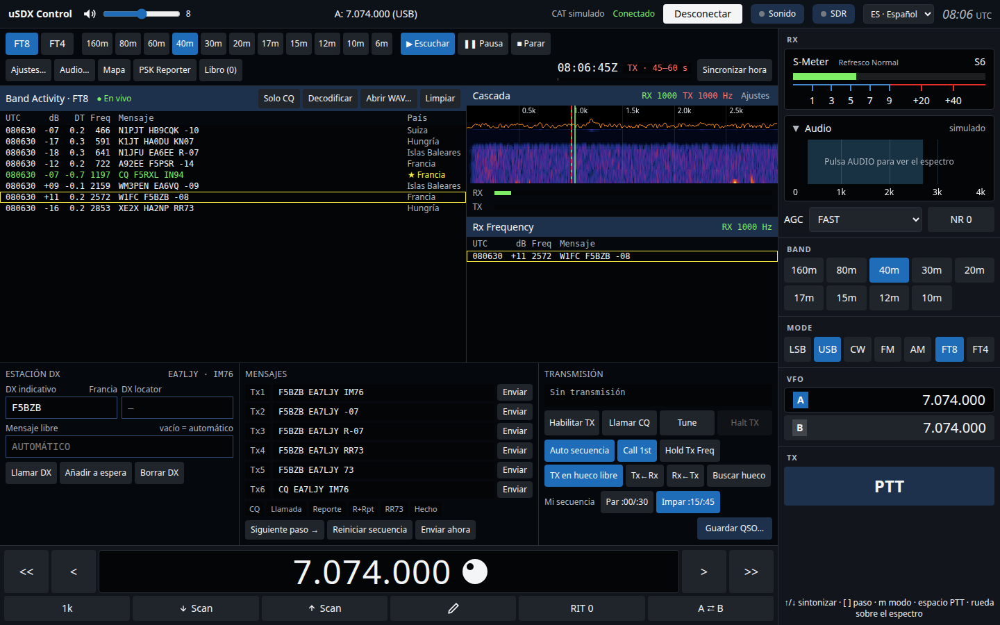
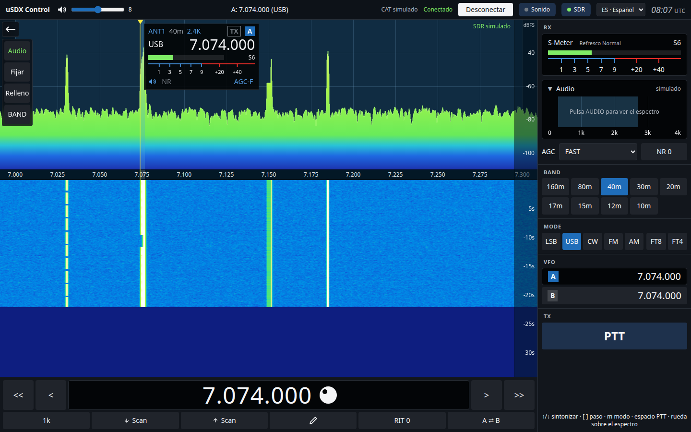
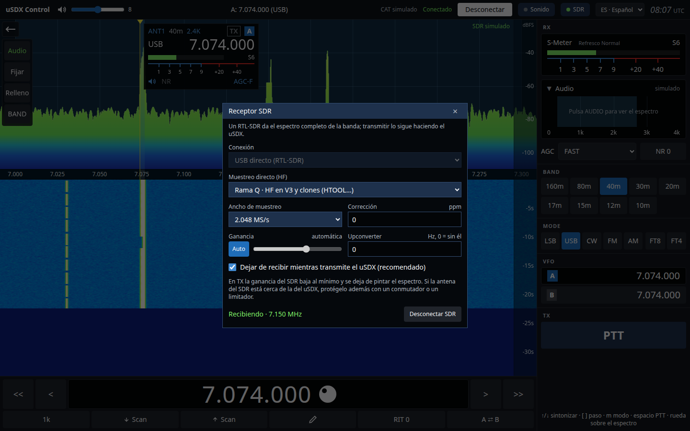

# uSDX Control

*[English](README.md) · Español*

Control del transceptor **uSDX** desde el ordenador: panadaptador y cascada, VFO A/B, bandas, modos, S-métrico y PTT por CAT. Incluye una estación **FT8/FT4** completa (al estilo WSJT-X) y admite un **RTL-SDR** como receptor de panorámico, que se calla solo cuando el uSDX transmite.



## Descargar e instalar

> **Versión beta.** Funciona y se usa a diario, pero aún puede tener fallos. Si encuentras alguno, abre una [issue](https://github.com/ea7ljy73/usdxcontrol/issues) indicando sistema, versión y qué estabas haciendo.

### 1. Descargar

1. Abre **[Releases](https://github.com/ea7ljy73/usdxcontrol/releases)** y elige la versión más reciente (la de arriba).
2. En **Assets**, descarga **solo el fichero de tu sistema**:

| Tu ordenador | Fichero que debes bajar |
| --- | --- |
| Windows 10/11 | `usdxcontrol-<versión>-win-x64.exe` |
| Mac con chip Apple (M1, M2, M3, M4…) | `usdxcontrol-<versión>-mac-arm64.dmg` |
| Mac con procesador Intel | `usdxcontrol-<versión>-mac-x64.dmg` |
| Ubuntu, Debian, Linux Mint… | `usdxcontrol-<versión>-linux-amd64.deb` |
| Cualquier otro Linux | `usdxcontrol-<versión>-linux-x86_64.AppImage` |

¿No sabes qué Mac tienes? Menú Apple → *Acerca de este Mac*: pone *Chip Apple M…* o *Procesador Intel…*. Los ficheros *Source code* no hacen falta: son solo para desarrolladores.

### 2. Instalar

**Windows**

1. Haz doble clic en el `.exe`. Se instala solo y crea un acceso directo en el escritorio.
2. La app no está firmada, así que Windows puede mostrar *«Windows protegió su PC»*: pulsa **Más información → Ejecutar de todas formas**.
3. Si luego no aparece el puerto de la radio, instala el driver de tu cable USB (CH340 o CP210x).

**macOS**

1. Abre el `.dmg` y arrastra **uSDX Control** a **Aplicaciones**.
2. La app no está firmada, así que la primera vez macOS la bloquea. Ábrela una vez, ve a **Ajustes del Sistema → Privacidad y seguridad** y pulsa **Abrir igualmente** (en macOS antiguos: clic derecho sobre la app → *Abrir*).
3. Si macOS dice que la app *«está dañada»*, ejecuta en Terminal `xattr -cr "/Applications/uSDX Control.app"` y vuelve a abrirla.
4. Permite el acceso al micrófono cuando lo pida: la app lo necesita para oír la tarjeta de sonido de la radio.

**Linux (Debian/Ubuntu)**

```sh
sudo apt install ./usdxcontrol-<versión>-linux-amd64.deb
sudo usermod -aG dialout $USER   # acceso al puerto serie de la radio
```

Cierra sesión y vuelve a entrar, y abre **uSDX Control** desde el menú de aplicaciones.

**Linux (AppImage)**

```sh
chmod +x usdxcontrol-<versión>-linux-x86_64.AppImage
sudo usermod -aG dialout $USER   # acceso al puerto serie de la radio
./usdxcontrol-<versión>-linux-x86_64.AppImage
```

Cierra sesión y vuelve a entrar una vez para que se aplique el grupo `dialout`.

### 3. Primeros pasos

Conecta el uSDX por USB, abre la app, elige el puerto serie en la barra superior y pulsa **Conectar**. El **[tutorial de primeros pasos](docs/es/tutorial.md)** te lleva desde aquí hasta tu primer QSO en FT8.

Más: [Manual de usuario](docs/es/manual.md) · [Detalles de instalación, udev y RTL-SDR](docs/es/instalacion.md)

## Capturas

| Panorámico con RTL-SDR | Ajustes del SDR |
| --- | --- |
|  |  |

## Qué hace

- **Control CAT** del uSDX por USB-serie: frecuencia, VFO A/B, RIT, modo, AGC, NR, volumen y PTT (también con la barra espaciadora).
- **Panadaptador y cascada** con sintonía por clic, arrastre, rueda o cursores.
- **FT8 y FT4** (recepción y transmisión): decodificación con varias pasadas y SNR/DT como WSJT-X, Band Activity y Rx Frequency, Tx1–Tx6, auto secuencia, Call 1st, Hold Tx Freq, búsqueda de hueco libre para TX, DIGI Mode del uSDX automático por CAT, Tune, watchdog, mapa de estaciones, PSK Reporter, libro de guardia con importación y exportación ADIF y marcas de país o indicativo nuevo.
- **Audio**: elección de las tarjetas de entrada y salida de la radio y escucha de la radio por los altavoces del PC.
- **RTL-SDR** (V3 y clones como HTOOL) por USB directo o por `rtl_tcp`. El SDR deja de recibir mientras el uSDX transmite.
- **Interfaz en español e inglés**: se elige en la barra superior y se recuerda.
- **Modo demostración** sin radio: abre la app con `?radio=mock` en la versión web.

## Desarrollo

Requiere Node 24 y pnpm 10.

```sh
pnpm install
pnpm dev            # versión web en http://localhost:5173 (?radio=mock para simular)
pnpm dev:desktop    # app de escritorio
pnpm lint && pnpm test && pnpm test:e2e && pnpm test:desktop
pnpm capturas       # regenera las capturas de docs/capturas/{es,en}
```


El motor FT8/FT4 es WebAssembly compilado desde [ft8_lib](https://github.com/kgoba/ft8_lib) (MIT). Su fuente está en `native/ftx/` y se recompila con `native/ftx/build.sh` (necesita Docker); el resultado se guarda en `src/features/digital/infrastructure/vendor/`.

Antes de empaquetar, `pnpm licenses:third-party` regenera `THIRD_PARTY_LICENSES.txt` (lo hace también `pnpm dist` y la CI). Si añades una dependencia que acaba dentro de la app, añádela a la lista de `scripts/third-party-licenses.cjs`.

## Traducciones

Los textos de la interfaz están en `src/i18n/messages/`: `es.ts` es el catálogo de referencia y `en.ts` su traducción. El compilador comprueba que cada idioma tiene todas las claves. Para añadir otro idioma, copia `en.ts`, tradúcelo y añade su código a `LOCALES` y `LOCALE_NAMES` en `src/i18n/i18n.ts`. La documentación de usuario está en `docs/es/` y `docs/en/`.

## Licencia

[MIT](LICENSE) © 2026 jgalera. Los componentes de terceros incluidos (ft8_lib, KISS FFT, React, Radix, Leaflet, serialport, webrtlsdr…) mantienen sus licencias, recogidas en [THIRD_PARTY_LICENSES.txt](THIRD_PARTY_LICENSES.txt).
