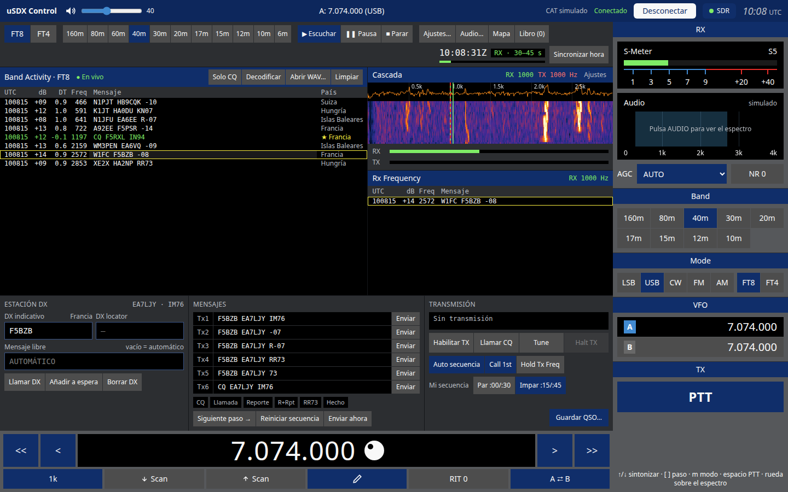
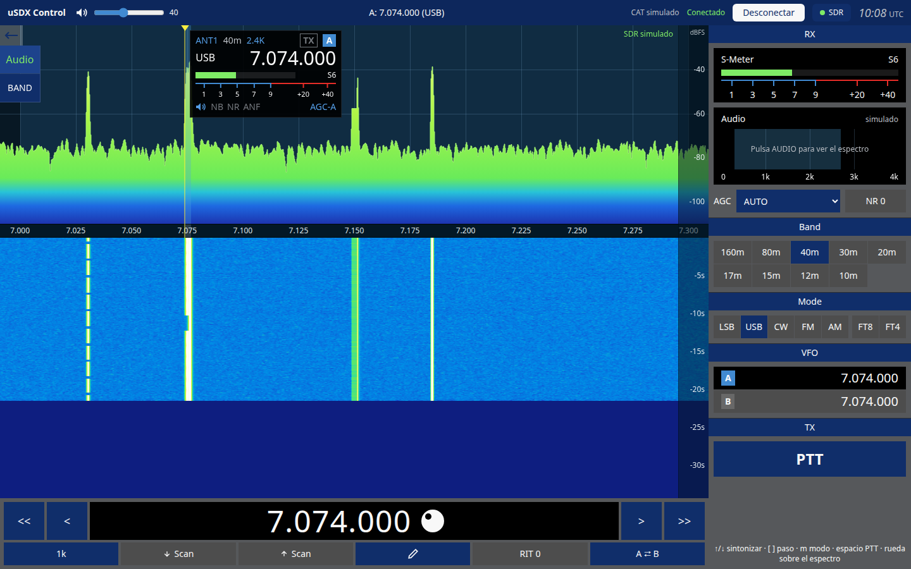
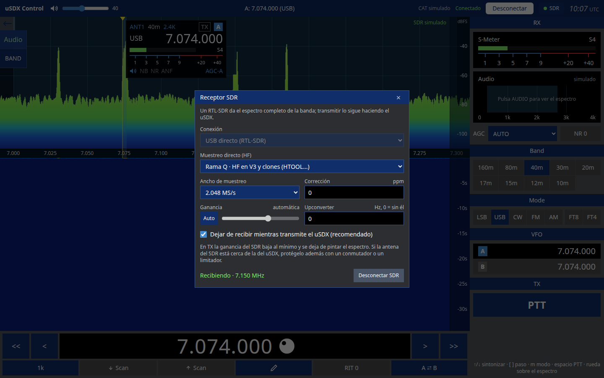

# uSDX Control

Control del transceptor **uSDX** desde el ordenador: panadaptador y cascada, VFO A/B, bandas, modos, S-métrico y PTT por CAT. Incluye una estación **FT8/FT4** completa (al estilo WSJT-X) y admite un **RTL-SDR** como receptor de panorámico, que se calla solo cuando el uSDX transmite.



## Descargas

Los instaladores de cada versión están en **[Releases](https://github.com/ea7ljy73/usdxcontrol/releases/latest)**.

| Sistema | Fichero | Notas |
| --- | --- | --- |
| Windows 10/11 (x64) | `usdxcontrol-<versión>-win-x64.exe` | Instalador NSIS |
| macOS Apple Silicon | `usdxcontrol-<versión>-mac-arm64.dmg` | Sin firmar: la primera vez, clic derecho → *Abrir* |
| macOS Intel | `usdxcontrol-<versión>-mac-x64.dmg` | Sin firmar: la primera vez, clic derecho → *Abrir* |
| Linux (cualquier distribución) | `usdxcontrol-<versión>-linux-x86_64.AppImage` | `chmod +x` y ejecutar |
| Linux Debian/Ubuntu | `usdxcontrol-<versión>-linux-amd64.deb` | `sudo apt install ./usdxcontrol-….deb` |

[Todas las versiones](https://github.com/ea7ljy73/usdxcontrol/releases) · [Manual de usuario](docs/manual-usuario.md) · [Instalación y permisos del puerto serie](docs/instalacion-electron.md)

## Capturas

| Panorámico con RTL-SDR | Ajustes del SDR |
| --- | --- |
|  |  |

## Qué hace

- **Control CAT** del uSDX por USB-serie: frecuencia, VFO A/B, RIT, modo, AGC, NR, volumen y PTT (también con la barra espaciadora).
- **Panadaptador y cascada** con sintonía por clic, arrastre, rueda o cursores.
- **FT8 y FT4**: decodificación, Band Activity y Rx Frequency, Tx1–Tx6, auto secuencia, Call 1st, Hold Tx Freq, Tune, watchdog, mapa de estaciones, libro de guardia con importación y exportación ADIF y marcas de país o indicativo nuevo.
- **RTL-SDR** (V3 y clones como HTOOL) por USB directo o por `rtl_tcp`. El SDR deja de recibir mientras el uSDX transmite.
- **Modo demostración** sin radio: abre la app con `?radio=mock` en la versión web.

## Desarrollo

Requiere Node 24 y pnpm 10.

```sh
pnpm install
pnpm dev            # versión web en http://localhost:5173 (?radio=mock para simular)
pnpm dev:desktop    # app de escritorio
pnpm lint && pnpm test && pnpm test:e2e && pnpm test:desktop
```
