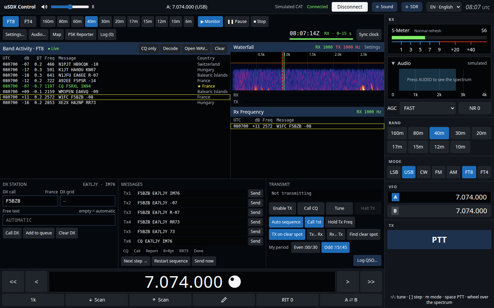
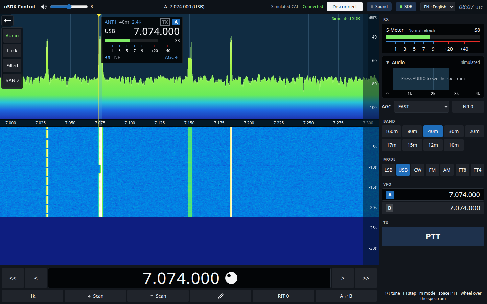
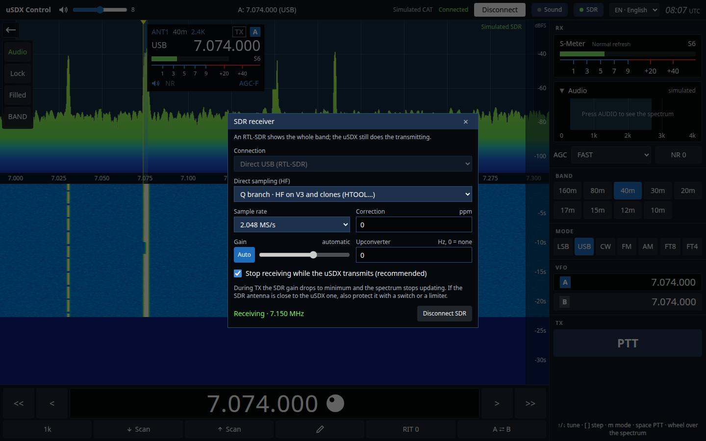

# uSDX Control user manual

*[Versión en español](../es/manual.md)* · First time? Start with the [tutorial](tutorial.md).

uSDX Control drives a uSDX transceiver from the computer through its CAT port (USB-serial). On screen, the spectrum and waterfall fill the centre, the dial sits at the bottom and the radio controls are on the right. It also includes a complete FT8/FT4 station and can use an RTL-SDR to show the whole band.

## 1. Installation

Download the installer for your system from [Releases](https://github.com/ea7ljy73/usdxcontrol/releases):

- **Windows**: run `usdxcontrol-<version>-win-x64.exe`. If the uSDX port does not show up, install the driver for your USB-serial adapter (CH340 or CP210x).
- **macOS**: open the `.dmg` (arm64 for Apple Silicon, x64 for Intel) and drag the app to Applications. The app is not signed, so the first time open it with right-click → *Open*.
- **Linux**: use the AppImage (`chmod +x` and run) or the `.deb` (`sudo apt install ./usdxcontrol-….deb`). To access the serial port your user must be in the `dialout` group: `sudo usermod -aG dialout $USER`, then log out and back in.

Permissions and udev rules are covered in the [installation guide](installation.md).

## 2. Connecting the radio

1. Connect the uSDX over USB. The CAT link runs at 38400 baud, 8N1, and the app sets it up on its own.
2. In the top bar, pick the **serial port** and press **Connect**.
3. When the indicator shows **Connected**, the app reads the frequency, mode and S-meter from the uSDX and stays in sync with the radio.

**Disconnect** releases the port. If there is a communication error, it is shown in red next to the button.

## 3. Main screen

### Top bar

- uSDX **volume**.
- **Frequency and mode** of the active VFO.
- CAT status and the **Connect/Disconnect** button.
- **Sound** button: the radio sound cards and monitoring on the PC (see section 5). The green dot means you are listening to the radio through the PC speakers.
- **SDR** button: the green dot means the SDR is receiving (see section 6).
- **Language** selector (ES · Español / EN · English). The first time the app uses the system language; your choice is remembered.
- **UTC** time.

### Panadapter and waterfall

- **Click** on the spectrum: tunes that frequency, snapped to the step grid.
- **Drag**: moves the dial in whole steps.
- **Mouse wheel**: one step up or down.
- **Marking the dial**: the dial is marked while you hold the mouse button and released when you let go. With a **double-click** (or Enter on the keyboard) it stays locked: the **arrow keys** move it step by step (hold them to repeat). Unlock it with another double-click or **Escape**.
- **Left menu** (← button):
  - **Audio** connects the radio audio from the sound card to show the audio spectrum. Without an SDR, the panadapter is drawn from this audio.
  - **Lock / Unlock**: marks or unmarks the dial, same as a double-click. Meant for touch screens.
  - **Filled / Line / Soft**: spectrum style. *Filled* paints the colour gradient under the curve, *Line* leaves only the curve and *Soft* adds a faint fill. The app remembers your choice.
  - Panadapter **span**: press to change the zoom.
- The slice flag shows the antenna, band, filter, mode, frequency and S-meter. **NR** and **AGC** can be clicked right there: NR goes up one level (0–8, after 8 it goes back to off) and AGC cycles through OFF, Fast and Slow. They need firmware v2.2.0 or later.

### Dial (bottom)

- `<<` `<` `>` `>>`: ten steps or one step down or up.
- **Step** (1 k, 100, …): press to change it.
- **Scan ↓ / Scan ↑**: scanning; it stops when a signal appears in the passband.
- **✎ Edit frequency**: type the frequency and press Enter to apply it or Esc to cancel.
- **RIT 0**: clears the RIT.
- **A ⇄ B**: swaps the VFOs.

### Right panel

- **S-Meter** and **Audio** spectrum. Click the *Audio* header to collapse or expand its spectrum and save space; the app remembers whether you left it collapsed. The **refresh** button next to the S-meter changes how often it is read (every reading is heard as a click on the uSDX).
- **AGC** and **NR**: press NR to raise the noise reduction level.
- **Band**: jumps to the usual frequency of each band, from 160 m to 10 m.
- **Mode**: LSB, USB, CW, FM and AM, plus FT8 and FT4, which open the digital station.
- **VFO**: press A or B to activate it.
- **PTT**: hold to transmit.

### Keyboard shortcuts

| Key | Action |
| --- | --- |
| ↑ / ↓ | One step up or down |
| `[` / `]` | Smaller or larger tuning step |
| `m` / `M` | Next or previous mode |
| Space (hold) | PTT |

Shortcuts do nothing while you are typing in a text field.

## 4. FT8 / FT4 station

Press **FT8** or **FT4** under *Mode*. The digital station replaces the panadapter, puts the radio in USB and tunes it to the band's FT8 frequency. With the extended firmware (v2.2.0 or later) it also turns on **DIGI Mode** on the uSDX (menu 029, flat TX for digital modes); unticking FT8/FT4 turns it off again.

### First time

1. Open **Settings…** and enter **My callsign** and **My grid**. There you also choose whether to end QSOs with RR73 or 73, the TX watchdog time and whether the TX period (even or odd) is chosen automatically.
2. In **Sound** (top bar) or **Audio…** (FT8 toolbar), pick the input (the uSDX audio coming into the computer) and the output (the audio going to the uSDX to transmit).
3. If the computer clock is not accurate, use **Sync clock**. FT8 needs an error below 1 s.

### Toolbar

- **FT8 / FT4**: protocol. Both receive and transmit.
- **Bands**: FT8 frequencies from 160 m to 6 m.
- **Monitor / Pause / Stop**: control reception.
- **Settings…**, **Audio…**, **Map** (decoded stations by grid), **PSK Reporter** (who is decoding your signal) and **Log** (saved QSOs, with ADIF import and export).
- UTC clock and countdown of the current cycle.

### Band Activity

Shows every decode of the cycle: UTC, dB, DT, audio frequency, message and country.

- **dB** is the SNR in 2500 Hz, computed like WSJT-X (from −24 dB upwards). It is the one sent as report.
- **DT** is the offset from the start of the transmission (0.5 s after the start of the cycle). If almost every station shows more than ±1 s, the computer clock is off: use *Sync clock*.
- The cycle is decoded at 14.4 s (FT8) or 6.7 s (FT4), in several passes: once the strong signals are found they are subtracted and the weak ones they were hiding are searched for.
- Cycles in which you transmit are not decoded, as in WSJT-X.

- **CQ only**: shows only CQ calls.
- **Decode**: decodes the last cycle again.
- **Open WAV…**: decodes a recording in FT8 and FT4, cycle by cycle from its start (up to 2 minutes).
- **Clear**: empties the list.

The **★** (new country or callsign) and **✓** (already worked) marks come from the log. Green lines are CQs, and those addressed to you are highlighted.

**Click on a decode**: that station becomes the DX station and messages Tx1–Tx6 are prepared.

### Waterfall and Rx Frequency

- **Click** on the waterfall sets the **RX** frequency (green marker). Your TX does not move.
- **Shift + click** sets only the **TX** frequency (dashed red marker).
- TX goes from 200 to **2300 Hz** at most: the uSDX samples the transmit audio at 4800 Hz and above 2400 Hz the signal would come out mirrored and nobody would decode it.
- **Ctrl + click** sets both, unless *Hold Tx Freq* is on.
- **Tx←Rx** and **Rx←Tx** copy one frequency to the other.
- **Shift + F11 / F12** move TX down or up by 60 Hz in FT8 (90 Hz in FT4).
- Waterfall **Settings**: palette, spectrum, speed, brightness, contrast and noise floor.
- **Rx Frequency** shows only what is decoded within ±50 Hz of your RX frequency, that is, your QSO.

### Making a QSO

- **Reply to a CQ**: double-click the CQ line (or click it and then **Enable TX**). RX moves to the station and your TX stays where it is, so you do not transmit on top of it; **Ctrl + double-click** also moves your TX to their frequency. With **Auto sequence** on, the app sends the report, RR73 or 73 as the other station replies.
- **Call CQ**: press **Call CQ**. If *Call 1st* is on, the app replies to the first station that answers you. Otherwise callers are queued.
- **TX on clear spot** (on by default): when you press *Call CQ* or reply to a station, if your TX lands on another signal it first moves to the quietest area between 500 and 2350 Hz (with at least 30 Hz clear on each side if possible, as close as possible to where you were), based on what was decoded in the last 3 minutes. If your frequency is already clear, it does not move.
- **Find clear spot**: does the same whenever you want, for instance before replying with *Hold Tx Freq*. It only considers decoded signals: have a look at the waterfall in case there is a weak one.
- **Enable TX** with no QSO in progress calls the DX station, if there is one, or calls CQ.
- **Tx1–Tx6 / Send**: sends a specific message. **Send now** transmits it in the current cycle.
- **My period**: choose the even (:00/:30) or odd (:15/:45) period.
- **Tune**: sends a carrier to adjust the antenna or tuner for 60 s at most.
- **Halt TX** (or **Esc**): stops transmitting immediately.
- **Log QSO…**: saves it to the log.

The TX status shows the next period and its countdown. The watchdog disables TX after the configured time without any action from you.

**Tips for completing QSOs with low power**:

- Do not transmit on the frequency of the station you call: reply with a double-click, so your TX stays in place and, with *TX on clear spot*, moves off any other signal. That way the other callers do not cover you.
- A station with a pile-up (answering others) picks the strongest; it is easier with someone calling CQ with no replies.
- Call CQ on an empty area of the waterfall (*TX on clear spot* does it for you).
- Check **PSK Reporter** to see how far your signal reaches right now.

### Coming from WSJT-X

Controls and gestures are those of WSJT-X 2.7:

| WSJT-X | uSDX Control |
| --- | --- |
| Enable Tx / Halt Tx / Tune | Enable TX / Halt TX / Tune |
| Auto Seq, Call 1st, Hold Tx Freq | Auto sequence, Call 1st, Hold Tx Freq |
| Tx even/1st | My period: Even :00/:30 or Odd :15/:45 |
| Tx1–Tx6, Next / Now | Tx1–Tx6, Send / Send now |
| Double-click a message: reply (TX does not move) | Same |
| Ctrl + double-click: reply on their frequency | Same |
| Click / Shift + click / Ctrl + click on the waterfall | Same (RX / TX / both) |
| Tx←Rx, Rx←Tx | Same |
| Esc: Halt Tx · Shift + F11/F12: move TX | Same |
| Band Activity / Rx Frequency | Same, with the Country column |

What uSDX Control adds: **TX on clear spot** and **Find clear spot**, the station map, built-in **PSK Reporter** and the log.

### PSK Reporter

Shows on a map and in a list the stations that decoded your callsign in the last hour: receiver, grid, country, SNR, band and distance, with a summary (how many hear you, best SNR and the farthest one). Use it to check that your signal is getting out. It refreshes every 5 minutes while the window is open; PSK Reporter does not allow more frequent queries.

## 5. Audio settings

Open them with **Sound** in the top bar (always visible, also without a radio) or with **Audio…** in the FT8 toolbar; both open the same dialog:

- **Input (RX)**: the sound card that receives the uSDX audio. With its **gain** and the **RX** meter: set it so the background noise stays in the lower part of the bar.
- **Output (TX)**: the card that sends the FT8/FT4 audio to the uSDX. With the **transmit level** and the **TX** meter: raise the power on the uSDX and keep the audio level from clipping (use *Tune*).
- **Listen to the radio on the PC**: plays the received audio on another card (the computer speakers or headphones), with its own **volume**. It also works outside FT8. It cannot use the same card that goes to the radio: the app warns you and does not enable it.

The list of cards refreshes on its own when a device is plugged in or removed. If the names do not show up, accept the audio permission the browser asks for.

If the browser blocks audio, click anywhere in the window or press **Enable TX** again.

## 6. SDR receiver (RTL-SDR)

An RTL-SDR (V3 or clones such as HTOOL) shows the whole band on the panadapter. Audio reception and transmission are still done by the uSDX.

1. Press **SDR** in the top bar.
2. Choose the **Connection**:
   - **Direct USB**: the RTL-SDR plugged into the computer.
   - **rtl_tcp**: an `rtl_tcp` server on the network. Enter its host and port (usually 1234).
3. On HF, leave **Direct sampling** on *Q branch*, which is right for the V3 and HTOOL clones.
4. Set the **sample rate**, **ppm correction**, **gain** (automatic or manual) and, if you use an upconverter, its frequency in Hz.
5. Press **Connect SDR**. The status shows *Receiving · <centre frequency>*.

**SDR centring**:

- If the band fits in the sample rate, the SDR centres on it and you see the whole band.
- If it does not fit, the SDR follows the dial.

**While transmitting**: with *Stop receiving while the uSDX transmits* on, the SDR drops its gain to minimum and stops drawing while the uSDX transmits. The panadapter then shows **SDR paused · TX**. This pause only detects PTT given from the app; if you transmit with the radio's own PTT or VOX, the SDR is not paused. If the SDR antenna is close to the uSDX one, also protect it with a switch or a limiter.

**Preparing the system for direct USB**:

- **Linux**: the kernel DVB driver grabs the device, so it has to be blocked. Create `/etc/modprobe.d/rtlsdr.conf` with the line `blacklist dvb_usb_rtl28xxu`. Also add a udev rule granting access to USB `0bda:2838`.
- **Windows**: install the WinUSB driver with [Zadig](https://zadig.akeo.ie/) for the *Bulk-In, Interface 0* device.

## 7. Troubleshooting

| Symptom | Solution |
| --- | --- |
| The uSDX port does not show up | Install the CH340/CP210x driver. On Linux, check that your user is in the `dialout` group. |
| FT8 decodes nothing | Check the time (*Sync clock*), the audio input and the RX meter. Make sure *Monitor* is active (not *Pause*). |
| I cannot hear the radio on the PC | Turn on *Listen to the radio on the PC* in **Sound**, pick the speakers (not the radio card) and click in the window. |
| The sound card is in use | Close WSJT-X, JTDX or any other program that has it open. |
| I transmit (PTT) but PSK Reporter does not see me | The TX audio goes to another card, usually the PC speakers. In **Sound**, *Output (TX)* must be the card connected to the uSDX, not “System default”. If you hear the FT8 tones on the PC, that is it. |
| People hear me but I do not complete QSOs | Check *PSK Reporter*. If they hear you, transmit on a clear spot (*Hold Tx Freq*) and avoid pile-ups. |
| Enable TX does not transmit | Check the audio output and that your callsign is set. Press *Enable TX* again to unlock the audio. |
| The SDR does not connect over USB | On Linux, block `dvb_usb_rtl28xxu`. On Windows, install WinUSB with Zadig. Close any other program using the RTL-SDR. |
| The SDR spectrum is empty on HF | Turn on *Direct sampling · Q branch*, or set up the upconverter. |
