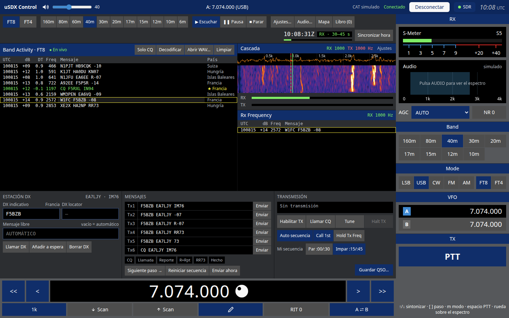
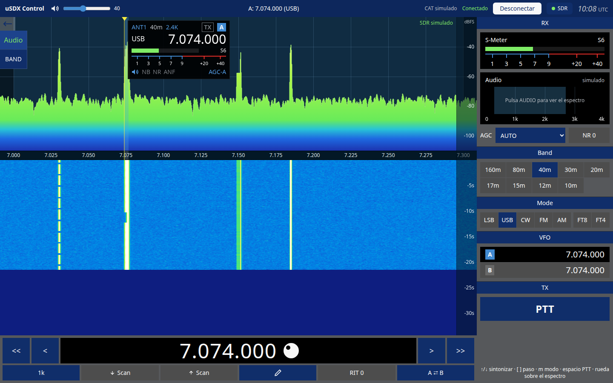
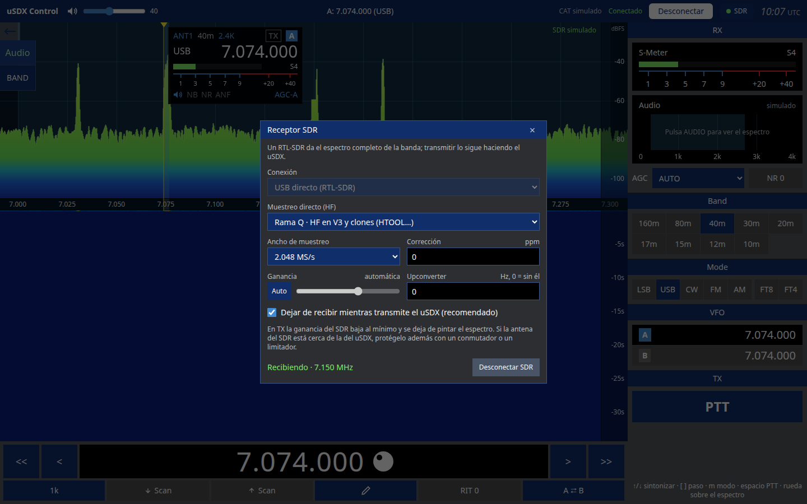

# Manual de usuario de uSDX Control

*[English version](../en/manual.md)* · ¿Primera vez? Empieza por el [tutorial](tutorial.md).

uSDX Control maneja un transceptor uSDX desde el ordenador por su puerto CAT (USB-serie). En la pantalla, el espectro y la cascada ocupan la parte central, el dial está abajo y los controles de la radio quedan a la derecha. Además trae una estación FT8/FT4 completa y puede usar un RTL-SDR para ver la banda entera.

## 1. Instalación

Descarga el instalador de tu sistema desde [Releases](https://github.com/ea7ljy73/usdxcontrol/releases):

- **Windows**: ejecuta `usdxcontrol-<versión>-win-x64.exe`. Si el puerto del uSDX no aparece, instala el driver de tu adaptador USB-serie (CH340 o CP210x).
- **macOS**: abre el `.dmg` (arm64 para Apple Silicon, x64 para Intel) y arrastra la app a Aplicaciones. La app no está firmada, así que la primera vez hay que abrirla con clic derecho → *Abrir*.
- **Linux**: puedes usar el AppImage (`chmod +x` y ejecutar) o el `.deb` (`sudo apt install ./usdxcontrol-….deb`). Para acceder al puerto serie, tu usuario debe estar en el grupo `dialout`: `sudo usermod -aG dialout $USER`, y después cierra y vuelve a abrir la sesión.

Los detalles de permisos y reglas udev están en la [guía de instalación](instalacion.md).

## 2. Conectar la radio

1. Conecta el uSDX por USB. El enlace CAT va a 38400 baudios, 8N1, y la app lo configura sola.
2. En la barra superior, elige el **puerto serie** y pulsa **Conectar**.

3. Cuando el indicador muestra **Conectado**, la app lee del uSDX la frecuencia, el modo y el S-métrico, y se mantiene sincronizada con la radio.

**Desconectar** libera el puerto. Si hay un error de comunicación, aparece en rojo junto al botón.

## 3. Pantalla principal

### Barra superior

- **Volumen** del uSDX.
- **Frecuencia y modo** del VFO activo.
- Estado del CAT y botón **Conectar/Desconectar**.
- Botón **Sonido**: tarjetas de sonido de la radio y escucha en el PC (ver apartado 5). El punto verde indica que estás escuchando la radio por los altavoces del PC.
- Botón **SDR**: el punto verde indica que el SDR está recibiendo (ver apartado 6).
- Selector de **idioma** (ES · Español / EN · English). La primera vez la app usa el idioma del sistema; lo que elijas se recuerda.
- Hora **UTC**.

### Panadaptador y cascada

- **Clic** en el espectro: sintoniza esa frecuencia, ajustada a la rejilla del paso.
- **Arrastrar**: mueve el dial por pasos enteros.
- **Rueda del ratón**: sube o baja un paso.
- **Marcar el dial**: el dial queda marcado mientras mantienes pulsado el botón del ratón y se desmarca al soltarlo. Con **doble clic** (o Intro con el teclado) queda fijado: los **cursores** lo mueven paso a paso (mantenlos pulsados para repetir). Se suelta con otro doble clic o con **Escape**.
- **Menú izquierdo** (botón ←):
  - **Audio** conecta el audio de la radio a la tarjeta de sonido para ver el espectro de audio. Sin SDR, el panorámico se dibuja a partir de este audio.
  - **Fijar / Soltar**: marca o desmarca el dial, igual que el doble clic. Pensado para pantallas táctiles.
  - **Relleno / Línea / Suave**: estilo del espectro. *Relleno* pinta el degradado de colores bajo la curva, *Línea* deja solo la curva y *Suave* añade un relleno tenue. La app recuerda tu elección.
  - **Ancho** del panadaptador: pulsa para cambiar el zoom.
- La bandera del slice muestra la antena, la banda, el filtro, el modo, la frecuencia y el S-métrico. **NR** y **AGC** se pueden pulsar ahí mismo: NR sube un nivel (0–8, tras el 8 vuelve a apagado) y AGC pasa por OFF, Fast y Slow. Necesitan el firmware v2.2.0 o posterior.

### Dial (parte inferior)

- `<<` `<` `>` `>>`: diez pasos o un paso abajo o arriba.
- **Paso** (1 k, 100, …): pulsa para cambiarlo.
- **Scan ↓ / Scan ↑**: búsqueda; se detiene al aparecer una señal en el pasabanda.
- **✎ Editar frecuencia**: escribe la frecuencia y pulsa Intro para aplicarla o Esc para cancelar.
- **RIT 0**: borra el RIT.
- **A ⇄ B**: intercambia los VFO.

### Panel derecho

- **S-Meter** y espectro de **Audio**. Pulsa la cabecera *Audio* para plegar o desplegar su espectro y ganar sitio; la app recuerda si lo dejaste plegado. El botón de **refresco** junto al S-Meter cambia cada cuánto se lee (cada lectura se oye como un chasquido en el uSDX).
- **AGC** y **NR**: pulsa NR para subir el nivel de reducción de ruido.
- **Band**: salta a la frecuencia habitual de cada banda, de 160 m a 10 m.
- **Mode**: LSB, USB, CW, FM y AM, más FT8 y FT4, que abren la estación digital.
- **VFO**: pulsa A o B para activarlo.
- **PTT**: mantén pulsado para transmitir.

### Atajos de teclado

| Tecla | Acción |
| --- | --- |
| ↑ / ↓ | Subir o bajar un paso |
| `[` / `]` | Paso de sintonía más pequeño o más grande |
| `m` / `M` | Modo siguiente o anterior |
| Espacio (mantener) | PTT |

Los atajos no actúan mientras escribes en un campo de texto.

## 4. Estación FT8 / FT4

Pulsa **FT8** o **FT4** en *Mode*. La estación digital sustituye al panadaptador, pone la radio en USB y la sintoniza en la frecuencia FT8 de la banda. Con el firmware ampliado (v2.2.0 o posterior) también activa **DIGI Mode** en el uSDX (menú 029, TX plano para modos digitales); al desmarcar FT8/FT4 se vuelve a quitar.

### Primera vez

1. Abre **Ajustes…** y escribe **Mi indicativo** y **Mi locator**. Ahí también eliges si cerrar los QSO con RR73 o con 73, el tiempo del watchdog de TX y si el turno de TX (par o impar) se elige solo.
2. En **Sonido** (cabecera) o **Audio…** (barra FT8), elige la entrada (el audio del uSDX que llega al ordenador) y la salida (el audio que va hacia el uSDX para transmitir).
3. Si la hora del ordenador no es exacta, usa **Sincronizar hora**. FT8 necesita un error de menos de 1 s.

### Barra de herramientas

- **FT8 / FT4**: protocolo. Los dos reciben y transmiten.
- **Bandas**: frecuencias FT8 de 160 m a 6 m.
- **Escuchar / Pausa / Parar**: controlan la recepción.
- **Ajustes…**, **Audio…**, **Mapa** (estaciones decodificadas por locator), **PSK Reporter** (quién decodifica tu señal) y **Libro** (QSO guardados, con importación y exportación ADIF).
- Reloj UTC y cuenta atrás del ciclo en curso.

### Band Activity

Muestra todos los decodificados del ciclo: UTC, dB, DT, frecuencia de audio, mensaje y país.

- **dB** es la SNR en 2500 Hz, calculada como en WSJT-X (de −24 dB en adelante). Es la que se envía como reporte.
- **DT** es el desfase respecto al inicio de la emisión (0,5 s tras el comienzo del ciclo). Si casi todas las estaciones salen con más de ±1 s, la hora del ordenador va desviada: usa *Sincronizar hora*.
- El ciclo se decodifica a los 14,4 s (FT8) o 6,7 s (FT4), con varias pasadas: tras sacar las señales fuertes se restan y se buscan las débiles que tapaban.
- Los ciclos en los que transmites no se decodifican, como en WSJT-X.

- **Solo CQ**: filtra las llamadas CQ.
- **Decodificar**: vuelve a decodificar el último ciclo.
- **Abrir WAV…**: decodifica una grabación en FT8 y en FT4, ciclo a ciclo desde su comienzo (hasta 2 minutos).
- **Limpiar**: borra la lista.

Las marcas **★** (país o indicativo nuevo) y **✓** (ya trabajado) salen del libro de guardia. Las líneas en verde son CQ, y las dirigidas a ti se resaltan.

**Clic en un decodificado**: esa estación pasa a ser la estación DX y se preparan los mensajes Tx1–Tx6.

### Cascada y Rx Frequency

- **Clic** en la cascada fija la frecuencia de **RX** (marca verde). Tu TX no se mueve.
- **Mayús + clic** fija solo la frecuencia de **TX** (marca roja discontinua).
- El TX va de 200 a **2300 Hz** como máximo: el uSDX muestrea el audio de transmisión a 4800 Hz y por encima de 2400 Hz la señal saldría reflejada y nadie la decodificaría.
- **Ctrl + clic** fija las dos, salvo que tengas *Hold Tx Freq* activado.
- **Tx←Rx** y **Rx←Tx** igualan una frecuencia a la otra.
- **Mayús + F11 / F12** bajan o suben el TX 60 Hz en FT8 (90 Hz en FT4).
- **Ajustes** de la cascada: paleta, espectro, velocidad, brillo, contraste y suelo de ruido.
- **Rx Frequency** muestra solo lo decodificado a ±50 Hz de tu frecuencia de RX, es decir, tu QSO.

### Hacer un QSO

- **Responder a un CQ**: doble clic en la línea del CQ (o clic y después **Habilitar TX**). El RX se va a la estación y tu TX se queda donde está, para no transmitir encima de ella; **Ctrl + doble clic** te lleva también el TX a su frecuencia. Con **Auto secuencia** activada, la app envía el informe, el RR73 o el 73 según vaya respondiendo la otra estación.
- **Llamar CQ**: pulsa **Llamar CQ**. Si *Call 1st* está activado, la app responde al primer corresponsal que te conteste. Si no, los que llaman quedan en espera.
- **TX en hueco libre** (activado de serie): al pulsar *Llamar CQ* o contestar a una estación, si tu TX pisa otra señal se mueve antes a la zona más despejada entre 500 y 2350 Hz (con al menos 30 Hz libres a cada lado si los hay, lo más cerca posible de donde estabas), según lo decodificado en los últimos 3 minutos. Si tu frecuencia ya está libre, no se mueve.
- **Buscar hueco**: hace lo mismo cuando quieras, por ejemplo antes de responder con *Hold Tx Freq*. Solo tiene en cuenta las señales decodificadas: echa un vistazo a la cascada por si hay alguna débil.
- **Habilitar TX** sin QSO en curso llama a la estación DX, si hay una, o lanza CQ.
- **Tx1–Tx6 / Enviar**: envía un mensaje concreto. **Enviar ahora** lo transmite en el ciclo en curso.
- **Mi secuencia**: elige el turno par (:00/:30) o impar (:15/:45).
- **Tune**: emite una portadora para ajustar la antena o el acoplador durante 60 s como máximo.
- **Halt TX** (o **Esc**): corta la transmisión de inmediato.
- **Guardar QSO…**: lo apunta en el libro.

El estado de TX indica el próximo turno y su cuenta atrás. El watchdog desactiva la TX tras el tiempo configurado sin intervención.

**Consejos para completar QSOs con poca potencia**:

- No transmitas en la frecuencia de la estación que llamas: responde con doble clic: tu TX se queda en su sitio y, con *TX en hueco libre*, sale de encima de cualquier otra señal. Así no te pisan los demás llamantes.
- Una estación con pila (va contestando a otros) elige al más fuerte; es más fácil con quien llama CQ sin respuestas.
- Lanza tu CQ en una zona vacía de la cascada (*TX en hueco libre* lo hace solo).
- Mira en **PSK Reporter** hasta dónde llega tu señal en ese momento.

### Si vienes de WSJT-X

Los controles y los gestos son los de WSJT-X 2.7:

| WSJT-X | uSDX Control |
| --- | --- |
| Enable Tx / Halt Tx / Tune | Habilitar TX / Halt TX / Tune |
| Auto Seq, Call 1st, Hold Tx Freq | Auto secuencia, Call 1st, Hold Tx Freq |
| Tx even/1st | Mi secuencia: Par :00/:30 (marcado) o Impar :15/:45 |
| Tx1–Tx6, Next / Now | Tx1–Tx6, Enviar / Enviar ahora |
| Doble clic en un mensaje: contestar (TX no se mueve) | Igual |
| Ctrl + doble clic: contestar en su frecuencia | Igual |
| Clic / Mayús + clic / Ctrl + clic en la cascada | Igual (RX / TX / los dos) |
| Tx←Rx, Rx←Tx | Igual |
| Esc: Halt Tx · Mayús + F11/F12: mover TX | Igual |
| Band Activity / Rx Frequency | Igual, con la columna País |

Lo que añade uSDX Control: **TX en hueco libre** y **Buscar hueco**, el mapa de estaciones, **PSK Reporter** integrado y el libro de guardia.

### PSK Reporter

Muestra en un mapa y en una lista las estaciones que han decodificado tu indicativo en la última hora: receptor, locator, país, SNR, banda y distancia, con un resumen (cuántas te oyen, mejor SNR y la más lejana). Sirve para comprobar que tu emisión sale bien. Se actualiza cada 5 minutos con la ventana abierta; PSK Reporter no admite consultas más frecuentes.

## 5. Ajustes de audio

Se abren con **Sonido** en la cabecera (siempre visible, también sin radio) o con **Audio…** en la barra FT8; los dos abren el mismo diálogo:

- **Entrada (RX)**: la tarjeta de sonido por la que llega el audio del uSDX. Con su **ganancia** y el medidor **RX**: ajusta para que el ruido de fondo quede en la parte baja de la barra.
- **Salida (TX)**: la tarjeta que lleva el audio FT8/FT4 al uSDX. Con el **nivel de transmisión** y el medidor **TX**: sube la potencia en el uSDX y deja el nivel de audio sin saturar (usa *Tune*).
- **Escuchar la radio en el PC**: saca el audio recibido por otra tarjeta (los altavoces o los cascos del ordenador), con su **volumen**. Funciona también fuera de FT8. No puede salir por la misma tarjeta que va a la radio: la app avisa y no la activa.

La lista de tarjetas se actualiza sola al enchufar o quitar un dispositivo. Si los nombres no aparecen, acepta el permiso de audio que pide el navegador.

Si el navegador bloquea el audio, haz clic en cualquier parte de la ventana o vuelve a pulsar **Habilitar TX**.

## 6. Receptor SDR (RTL-SDR)

Un RTL-SDR (V3 o clones como HTOOL) da el espectro de toda la banda en el panadaptador. La recepción de audio y la transmisión las sigue haciendo el uSDX.

1. Pulsa **SDR** en la barra superior.
2. Elige la **Conexión**:
   - **USB directo**: el RTL-SDR enchufado al ordenador.
   - **rtl_tcp**: un servidor `rtl_tcp` en red. Escribe su host y su puerto (normalmente 1234).
3. En HF, deja **Muestreo directo** en *Rama Q*, que es lo correcto para el V3 y los clones HTOOL.
4. Ajusta el **ancho de muestreo**, la **corrección ppm**, la **ganancia** (automática o manual) y, si usas upconverter, su frecuencia en Hz.
5. Pulsa **Conectar SDR**. El estado indica *Recibiendo · <frecuencia central>*.

**Centrado del SDR**:

- Si la banda cabe en el ancho de muestreo, el SDR se centra en ella y ves la banda entera.
- Si no cabe, el SDR sigue al dial.

**Durante la transmisión**: con *Dejar de recibir mientras transmite el uSDX* activado, el SDR baja la ganancia al mínimo y deja de pintar mientras el uSDX transmite. El panadaptador indica entonces **SDR en pausa · TX**. Esta pausa solo detecta el PTT que se da desde la app; si transmites con el PTT o el VOX de la propia radio, el SDR no se pausa. Si la antena del SDR está cerca de la del uSDX, protégela además con un conmutador o un limitador.

**Preparar el sistema para USB directo**:

- **Linux**: el driver DVB del kernel ocupa el dispositivo, así que hay que bloquearlo. Crea `/etc/modprobe.d/rtlsdr.conf` con la línea `blacklist dvb_usb_rtl28xxu`. Añade también una regla udev que dé acceso al USB `0bda:2838`.
- **Windows**: instala el driver WinUSB con [Zadig](https://zadig.akeo.ie/) para el dispositivo *Bulk-In, Interface 0*.

## 7. Problemas frecuentes

| Síntoma | Solución |
| --- | --- |
| El puerto del uSDX no aparece | Instala el driver CH340/CP210x. En Linux, comprueba que tu usuario está en el grupo `dialout`. |
| FT8 no decodifica nada | Revisa la hora (*Sincronizar hora*), la entrada de audio y el medidor RX. Comprueba que *Escuchar* está activo (no en *Pausa*). |
| No se oye la radio en el PC | Activa *Escuchar la radio en el PC* en **Sonido**, elige los altavoces (no la tarjeta de la radio) y haz clic en la ventana. |
| La tarjeta de sonido está en uso | Cierra WSJT-X, JTDX u otro programa que la tenga abierta. |
| Transmito (PTT) pero PSK Reporter no me ve | El audio de TX sale por otra tarjeta, normalmente los altavoces del PC. En **Sonido**, *Salida (TX)* tiene que ser la tarjeta conectada al uSDX, no «Predeterminada del sistema». Si oyes los pitidos FT8 por el PC, es eso. |
| Me oyen pero no completo QSOs | Mira *PSK Reporter*. Si te oyen, transmite en un hueco libre (*Hold Tx Freq*) y evita las pilas. |
| Habilitar TX no transmite | Comprueba la salida de audio y que el indicativo esté configurado. Pulsa de nuevo *Habilitar TX* para desbloquear el audio. |
| El SDR no conecta por USB | En Linux, bloquea `dvb_usb_rtl28xxu`. En Windows, instala WinUSB con Zadig. Cierra cualquier otro programa que use el RTL-SDR. |
| El espectro del SDR está vacío en HF | Activa *Muestreo directo · Rama Q*, o configura el upconverter. |
