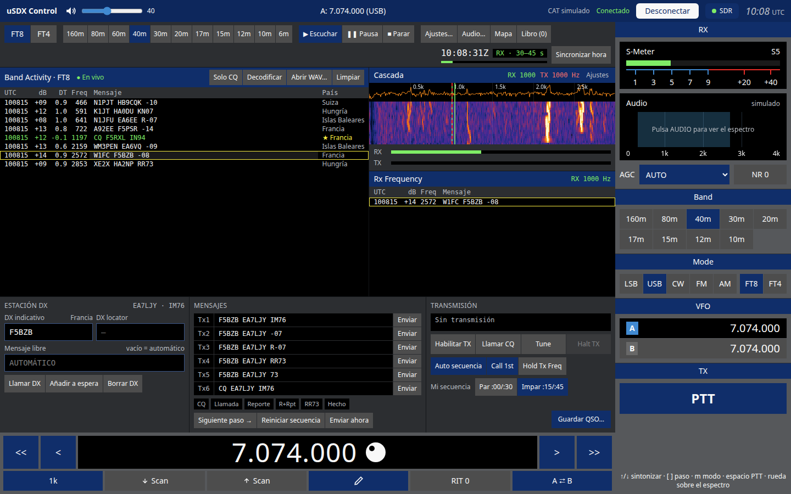
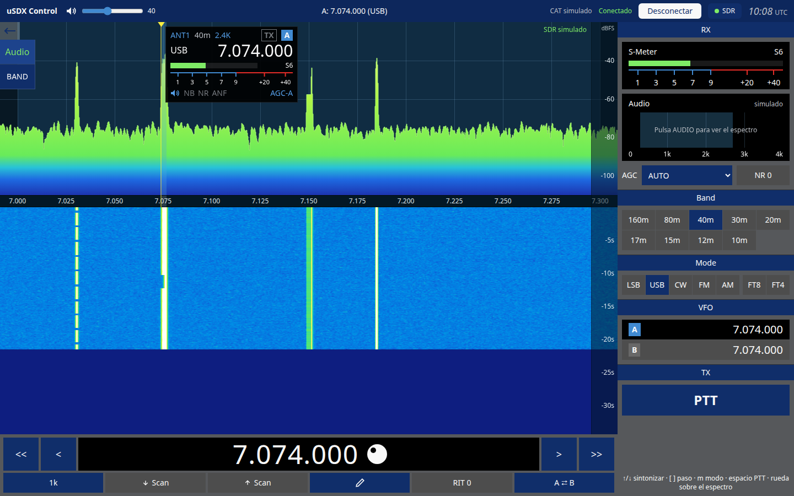
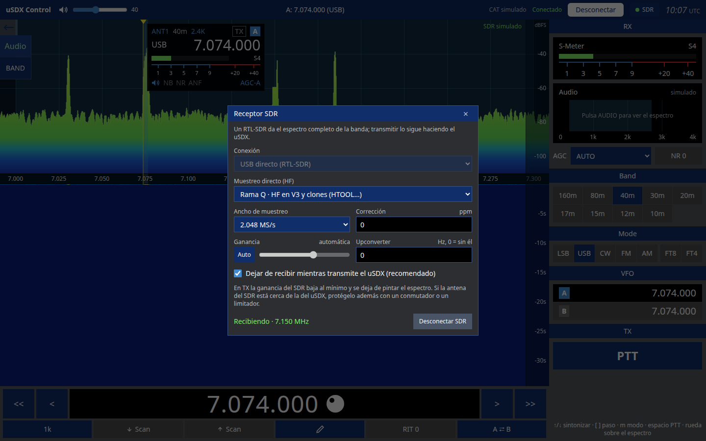

# Manual de usuario de uSDX Control

uSDX Control maneja un transceptor uSDX desde el ordenador por su puerto CAT (USB-serie). La pantalla sigue el estilo de SmartSDR: el espectro y la cascada ocupan la parte central, el dial está abajo y los controles de la radio quedan a la derecha. Además trae una estación FT8/FT4 completa y puede usar un RTL-SDR para ver la banda entera.

## 1. Instalación

Descarga el instalador de tu sistema desde [Releases](https://github.com/ea7ljy73/usdxcontrol/releases/latest):

- **Windows**: ejecuta `usdxcontrol-<versión>-win-x64.exe`. Si el puerto del uSDX no aparece, instala el driver de tu adaptador USB-serie (CH340 o CP210x).
- **macOS**: abre el `.dmg` (arm64 para Apple Silicon, x64 para Intel) y arrastra la app a Aplicaciones. La app no está firmada, así que la primera vez hay que abrirla con clic derecho → *Abrir*.
- **Linux**: puedes usar el AppImage (`chmod +x` y ejecutar) o el `.deb` (`sudo apt install ./usdxcontrol-….deb`). Para acceder al puerto serie, tu usuario debe estar en el grupo `dialout`: `sudo usermod -aG dialout $USER`, y después cierra y vuelve a abrir la sesión.

Los detalles de permisos y reglas udev están en [instalacion-electron.md](instalacion-electron.md).

## 2. Conectar la radio

1. Conecta el uSDX por USB. El enlace CAT va a 38400 baudios, 8N1, y la app lo configura sola.
2. En la barra superior, elige el **puerto serie** y pulsa **Conectar radio**.
3. Cuando el indicador muestra **Conectado**, la app lee del uSDX la frecuencia, el modo y el S-métrico, y se mantiene sincronizada con la radio.

**Desconectar** libera el puerto. Si hay un error de comunicación, aparece en rojo junto al botón.

## 3. Pantalla principal

### Barra superior

- **Volumen** del uSDX.
- **Frecuencia y modo** del VFO activo.
- Estado del CAT y botón **Conectar/Desconectar**.
- Botón **SDR**: el punto verde indica que el SDR está recibiendo (ver apartado 6).
- Hora **UTC**.

### Panadaptador y cascada

- **Clic** en el espectro: sintoniza esa frecuencia, ajustada a la rejilla del paso.
- **Arrastrar**: mueve el dial por pasos enteros.
- **Rueda del ratón**: sube o baja un paso.
- **Cursores**, con el panadaptador seleccionado: mueven el dial un paso (mantenlos pulsados para repetir).
- **Menú izquierdo** (botón ←):
  - **Audio** conecta el audio de la radio a la tarjeta de sonido para ver el espectro de audio. Sin SDR, el panorámico se dibuja a partir de este audio.
  - **Ancho** del panadaptador: pulsa para cambiar el zoom.
- La bandera del slice muestra la antena, la banda, el filtro, el modo, la frecuencia, el S-métrico y los indicadores NB, NR, ANF y AGC.

### Dial (parte inferior)

- `<<` `<` `>` `>>`: diez pasos o un paso abajo o arriba.
- **Paso** (1 k, 100, …): pulsa para cambiarlo.
- **Scan ↓ / Scan ↑**: búsqueda.
- **✎ Editar frecuencia**: escribe la frecuencia y pulsa Intro para aplicarla o Esc para cancelar.
- **RIT 0**: borra el RIT.
- **A ⇄ B**: intercambia los VFO.

### Panel derecho

- **S-Meter** y espectro de **Audio**.
- **AGC** y **NR**: pulsa NR para subir el nivel de reducción de ruido.
- **Band**: salta a la frecuencia habitual de cada banda, de 160 m a 10 m.
- **Mode**: LSB, USB, CW, FM y AM, más FT8 y FT4, que abren la estación digital.
- **VFO**: pulsa A o B para activarlo.
- **PTT**: mantén pulsado para transmitir.

### Atajos de teclado

| Tecla | Acción |
| --- | --- |
| ↑ / ↓ | Subir o bajar un paso |
| `[` / `]` | Paso de sintonía más pequeño o más grande |
| `m` / `M` | Modo siguiente o anterior |
| Espacio (mantener) | PTT |

Los atajos no actúan mientras escribes en un campo de texto.

## 4. Estación FT8 / FT4

Pulsa **FT8** o **FT4** en *Mode*. La estación digital sustituye al panadaptador, pone la radio en USB y la sintoniza en la frecuencia FT8 de la banda.

### Primera vez

1. Abre **Ajustes…** y escribe **Mi indicativo** y **Mi locator**. Ahí también eliges si cerrar los QSO con RR73 o con 73, el tiempo del watchdog de TX y si el turno de TX (par o impar) se elige solo.
2. En **Audio…**, elige la entrada (el audio del uSDX que llega al ordenador) y la salida (el audio que va hacia el uSDX para transmitir).
3. Si la hora del ordenador no es exacta, usa **Sincronizar hora**. FT8 necesita un error de menos de 1 s.

### Barra de herramientas

- **FT8 / FT4**: protocolo.
- **Bandas**: frecuencias FT8 de 160 m a 6 m.
- **Escuchar / Pausa / Parar**: controlan la recepción.
- **Ajustes…**, **Audio…**, **Mapa** (estaciones decodificadas por locator) y **Libro** (QSO guardados, con importación y exportación ADIF).
- Reloj UTC y cuenta atrás del ciclo en curso.

### Band Activity

Muestra todos los decodificados del ciclo: UTC, dB, DT, frecuencia de audio, mensaje y país.

- **Solo CQ**: filtra las llamadas CQ.
- **Decodificar**: vuelve a decodificar el último ciclo.
- **Abrir WAV…**: decodifica una grabación.
- **Limpiar**: borra la lista.

Las marcas **★** (país o indicativo nuevo) y **✓** (ya trabajado) salen del libro de guardia. Las líneas en verde son CQ, y las dirigidas a ti se resaltan.

**Clic en un decodificado**: esa estación pasa a ser la estación DX y se preparan los mensajes Tx1–Tx6.

### Cascada y Rx Frequency

- **Clic** en la cascada fija la frecuencia de **RX** (marca verde). También mueve la de TX, salvo que tengas *Hold Tx Freq* activado.
- **Mayús + clic** fija solo la frecuencia de **TX** (marca roja discontinua).
- **Ajustes** de la cascada: paleta, espectro, velocidad, brillo, contraste y suelo de ruido.
- **Rx Frequency** muestra solo lo decodificado a ±50 Hz de tu frecuencia de RX, es decir, tu QSO.

### Hacer un QSO

- **Responder a un CQ**: clic en la línea del CQ y después **Habilitar TX**. Con **Auto secuencia** activada, la app envía el informe, el RR73 o el 73 según vaya respondiendo la otra estación.
- **Llamar CQ**: pulsa **Llamar CQ**. Si *Call 1st* está activado, la app responde al primer corresponsal que te conteste. Si no, los que llaman quedan en espera.
- **Habilitar TX** sin QSO en curso llama a la estación DX, si hay una, o lanza CQ.
- **Tx1–Tx6 / Enviar**: envía un mensaje concreto. **Enviar ahora** lo transmite en el ciclo en curso.
- **Mi secuencia**: elige el turno par (:00/:30) o impar (:15/:45).
- **Tune**: emite una portadora para ajustar la antena o el acoplador durante 60 s como máximo.
- **Halt TX**: corta la transmisión de inmediato.
- **Guardar QSO…**: lo apunta en el libro.

El estado de TX indica el próximo turno y su cuenta atrás. El watchdog desactiva la TX tras el tiempo configurado sin intervención.

## 5. Ajustes de audio

La entrada y la salida se eligen en **Audio…**. Los medidores **RX** y **TX** bajo la cascada ayudan a ajustar niveles:

- **RX**: ajusta el volumen de entrada para que el ruido de fondo quede en la parte baja de la barra.
- **TX**: sube la potencia en el uSDX y deja el nivel de audio sin saturar.

Si el navegador bloquea el audio, vuelve a pulsar **Habilitar TX**.

## 6. Receptor SDR (RTL-SDR)

Un RTL-SDR (V3 o clones como HTOOL) da el espectro de toda la banda en el panadaptador. La recepción de audio y la transmisión las sigue haciendo el uSDX.

1. Pulsa **SDR** en la barra superior.
2. Elige la **Conexión**:
   - **USB directo**: el RTL-SDR enchufado al ordenador.
   - **rtl_tcp**: un servidor `rtl_tcp` en red. Escribe su host y su puerto (normalmente 1234).
3. En HF, deja **Muestreo directo** en *Rama Q*, que es lo correcto para el V3 y los clones HTOOL.
4. Ajusta el **ancho de muestreo**, la **corrección ppm**, la **ganancia** (automática o manual) y, si usas upconverter, su frecuencia en Hz.
5. Pulsa **Conectar SDR**. El estado indica *Recibiendo · <frecuencia central>*.

**Centrado del SDR**:

- Si la banda cabe en el ancho de muestreo, el SDR se centra en ella y ves la banda entera.
- Si no cabe, el SDR sigue al dial.

**Durante la transmisión**: con *Dejar de recibir mientras transmite el uSDX* activado, el SDR baja la ganancia al mínimo y deja de pintar mientras el uSDX transmite. El panadaptador indica entonces **SDR en pausa · TX**. Esta pausa solo detecta el PTT que se da desde la app; si transmites con el PTT o el VOX de la propia radio, el SDR no se pausa. Si la antena del SDR está cerca de la del uSDX, protégela además con un conmutador o un limitador.

**Preparar el sistema para USB directo**:

- **Linux**: el driver DVB del kernel ocupa el dispositivo, así que hay que bloquearlo. Crea `/etc/modprobe.d/rtlsdr.conf` con la línea `blacklist dvb_usb_rtl28xxu`. Añade también una regla udev que dé acceso al USB `0bda:2838`.
- **Windows**: instala el driver WinUSB con [Zadig](https://zadig.akeo.ie/) para el dispositivo *Bulk-In, Interface 0*.

## 7. Problemas frecuentes

| Síntoma | Solución |
| --- | --- |
| El puerto del uSDX no aparece | Instala el driver CH340/CP210x. En Linux, comprueba que tu usuario está en el grupo `dialout`. |
| FT8 no decodifica nada | Revisa la hora (*Sincronizar hora*), la entrada de audio y el medidor RX. |
| Habilitar TX no transmite | Comprueba la salida de audio y que el indicativo esté configurado. Pulsa de nuevo *Habilitar TX* para desbloquear el audio. |
| El SDR no conecta por USB | En Linux, bloquea `dvb_usb_rtl28xxu`. En Windows, instala WinUSB con Zadig. Cierra cualquier otro programa que use el RTL-SDR. |
| El espectro del SDR está vacío en HF | Activa *Muestreo directo · Rama Q*, o configura el upconverter. |
